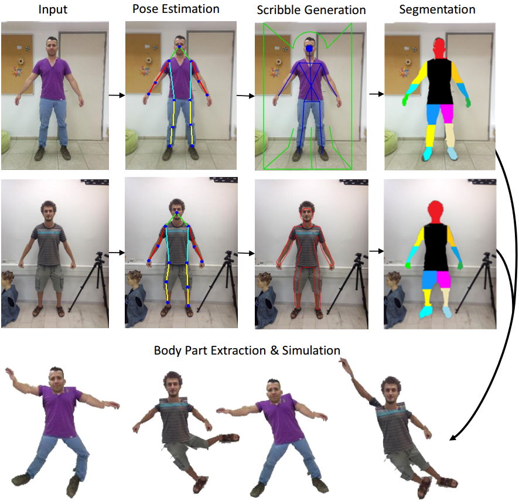

# Puppify - Planar Marionettes

[ **Updated and ported for modern hardware**](updated/README.md)

  

Puppify, *Automatic Generation of Planar Marionettes from Frontal Images*, is a Technion student project by **Elad Richardson and Gil Ben-Shachar**, supervised by **Anastasia Dubrovina and Aaron Wetzler**. GIP lists it under 2016; it was named among the 2015-16 Amdocs Best Project Contest winners in May 2016.

*The unchanged figure comes from the official GIP project listing. It shows historical project examples, including estimated poses and body-part cutouts, rather than output from a new run.*

## Project method

The [official project description](https://gip.cs.technion.ac.il/lab-projects.php?id=6) describes estimating body joints in a frontal photograph with a convolutional network, refining those estimates with skin-tone cues and a technique the report calls *reverse ensembling*, and generating foreground/background scribbles from the estimated skeleton. Segmentation and cropping then produce separate body-part images for repositioning and animation as a two-dimensional puppet.

The recovered [10-page report](docs/report.pdf) describes a Caffe joint-localization network trained on FashionPose, C++/OpenCV segmentation, and a puppet simulation based on a D3 force graph. Reverse ensembling combines model responses from transformed versions of an input image. The report discusses limitations from inaccurate scribbles, similar foreground/background colors and disconnected contour results. These are historical implementation descriptions and reported limitations, not a reproduced current benchmark.

## Available materials

- [Original project report](docs/report.pdf), 10 pages, recovered from a January 3, 2023 Internet Archive capture of the official GIP report URL. The PDF creation metadata is dated November 18, 2015; the project is listed under 2016 by GIP.
- [Historical project figure](assets/project-preview.png), preserved byte for byte from the GIP listing.
- [Official GIP project page](https://gip.cs.technion.ac.il/lab-projects.php?id=6) and [2016 project listing](https://gip.cs.technion.ac.il/last-projects.php#p2016).
- [Historical demo video](https://www.youtube.com/watch?v=RPFcZ8bozjM), linked by the official project page and titled *Pupify* on the GIP Technion channel. Its metadata was checked; the video content was not reviewed or copied into this repository.

The current report and presentation URLs returned HTTP 403 during recovery on November 15, 2026. The report was recovered from the archive. The archived presentation URL contained an unrelated one-slide lab notice, which was excluded; the actual final presentation remains unrecovered.

No original application source, trained model, executable or installation package has been recovered for this repository. The historical application has not been built, run or benchmarked during recovery. The separate new browser implementation and its checks are described in the [updated section](updated/README.md).

## Award

Technion's [May 10, 2016 announcement](https://www.cs.technion.ac.il/news/view-new.php?nwid=841) lists the project among the winners of the 2015-16 Amdocs Best Project Contest. The [July 4, 2016 ceremony report](https://www.cs.technion.ac.il/news/view-new.php?nwid=866) confirms the students and supervisors.

## Attribution and reuse

Credits follow the GIP project records and Technion news. Both Technion news records spell the name Aaron Wetzler; the GIP detail page and historical report have the variant “Weltzer.” This repository uses Wetzler.

Maintained by Aaron Wetzler, one of the original supervisors. The historical project work is credited to Elad Richardson and Gil Ben-Shachar.

No explicit open license was found on the GIP pages, Technion news records or in the report. The historical report and figure retain their existing rights; inclusion here adds no reuse permission. No new license is assigned to those historical materials. The separate browser implementation has its own scoped terms. Original authors or rights holders can open an issue to contribute missing material, correct attribution, or request removal. The [provenance record](PROVENANCE.json) lists source URLs, recovery checks and the image and report SHA-256 hashes.
