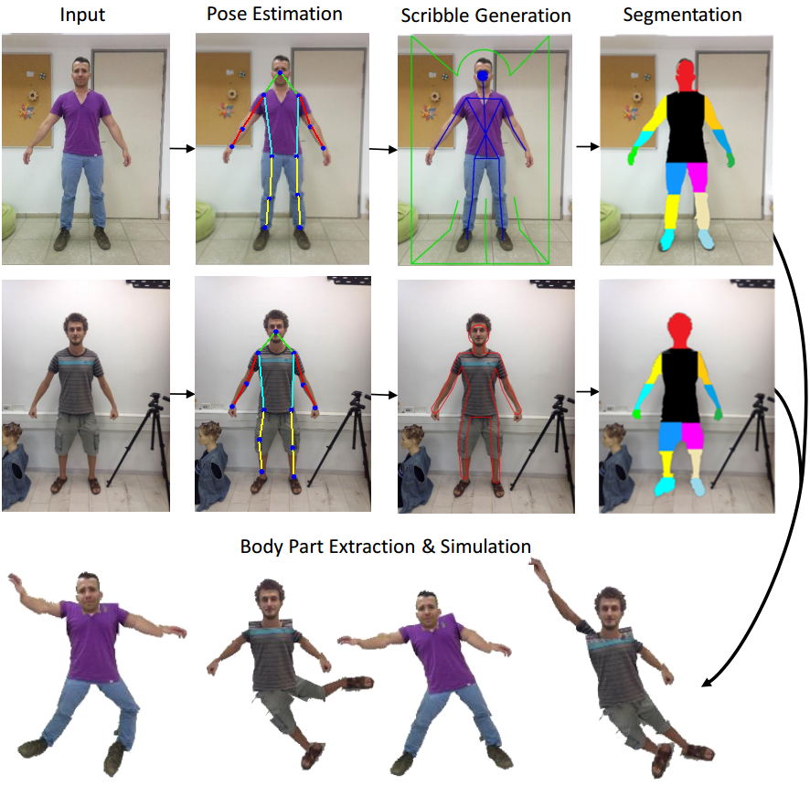

# Puppify — Planar Marionettes

Puppify investigated turning a frontal photograph into separate body-part cutouts that could be posed as a two-dimensional puppet. The report describes joint estimation, generated segmentation scribbles and a puppet simulation.

Original project: **Elad Richardson and Gil Ben-Shachar**. Supervision: **Anastasia Dubrovina and Aaron Wetzler**.

*Unchanged official project diagram showing historical examples.*

The original report and figure are preserved; original code and trained models are missing. The project is listed under 2016 and was among the 2015–16 Amdocs Best Project Contest winners.

## Updated

**[Open the browser demo](https://twerdster.github.io/planar-marionettes/)** · [Updated guide](updated/README.md)

The new browser app uses self-hosted MediaPipe pose/foreground inference, geometric body-part cuts and Canvas posing. Correct joints, drag the puppet, transfer motion from a video and export a transparent PNG. It is not a port of the historical Caffe/OpenCV/D3 pipeline. Crossed/hidden limbs and missing texture can produce errors; physical phones and Safari remain untested.

[Setup (Node.js 22.12+), model/media terms and checks](updated/DETAILS.md) · [Browser guide](updated/browser/README.md)

## Project record and rights

New browser code has a scoped [MIT license](updated/browser/LICENSE); the example media remains CC BY-SA 4.0.

[Historical context, attribution and recovery details](PROJECT_RECORD.md) preserve the earlier record. Original material, datasets, dependencies and new code keep their separately stated terms; no blanket license is added.
