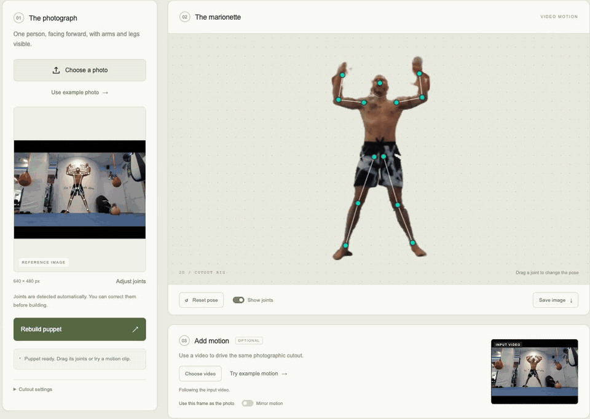

# Updated and ported for modern hardware

This browser application turns a full-body photograph into a jointed, two-dimensional cutout. You can correct detected joints, pose the cutout by dragging them, apply motion from a video and save the current pose as a transparent PNG.

**[Open the browser app](https://twerdster.github.io/planar-marionettes/)** · [Application source](browser) · [Recorded checks](browser/docs/VALIDATION.md)

**This is new work by Aaron Wetzler, developed from the recovered Puppify report.** No original application source, trained model or executable was recovered. It is not a repaired copy of the students' code or a reproduction of their reported results. The original project by Elad Richardson and Gil Ben-Shachar, supervised by Anastasia Dubrovina and Aaron Wetzler, remains documented in the [historical record](../README.md) and [unchanged report](../docs/report.pdf).



Actual browser recording; the reference photograph supplies the cutout textures, and the input video supplies motion. [MP4 recording](media/puppify-browser-demo.mp4) · [Still image](media/editor.png). Example-derived media: Taco Fleur / Cavemantraining, CC BY-SA 4.0; [source, changes and recording details](media/MEDIA_NOTICES.md). This one-person demonstration is not an accuracy benchmark.

## Run it locally

Install Node.js **22.12 or later**, then run from this repository:

```sh
cd updated/browser
npm ci
npm run dev
```

Open the local URL printed by Vite. Use **Use example photo**, then **Build puppet**. Drag a joint on the resulting cutout, or choose **Try example motion**. For your own material, start with one front-facing person whose arms and legs are visible. A paused video frame can also become the reference photograph.

The model and WebAssembly files are included in the repository. The app serves them locally; no inference account or API key is needed. A browser with Web Workers, OffscreenCanvas, WebAssembly and Canvas 2D is required. Browser decoding determines which image and video formats work. See the [browser guide](browser/README.md) for the full workflow, deployment, tests and asset checks.

## What changed from the report

The historical pipeline used a Caffe/FashionPose pose model, generated scribbles, C++/OpenCV segmentation and a D3 force-graph puppet. This implementation uses **MediaPipe Pose Landmarker** for joints and a whole-person mask, a new geometric partition for ten body-part cutouts, and **Canvas 2D** for rendering and joint constraints. It does not reproduce the original reverse ensembling, skin-based refinement, Dijkstra/FIGTree segmentation or D3 simulation.

Video-driven posing is a new extension. It changes the rig using detected joint directions while preserving the reference photograph's bone lengths. Uncertain joint directions hold their previous values. The reference textures stay fixed; the app does not repeatedly cut out each video frame.

## Verification and limits

Thirteen focused geometry/data tests cover inverse kinematics, preserved bone lengths, uncertain detections, mirrored references, mask handling, raised-hand assignment, conservative fragment cleanup, stage fitting and mirrored motion. They check those operations, not pose-model accuracy. The [validation record](browser/docs/VALIDATION.md) records the actual browser checks and their environment. There is no reproduction of the original benchmark or independent landmark/segmentation ground truth for the supplied demonstration.

A person mask supplies foreground probabilities, not body-part labels. Geometric assignment can fail with crossed limbs, occlusions, loose clothing and side views. The torso is rigid and the drawing order is fixed. Hidden surfaces are not reconstructed; moving a part can expose a gap or an incorrect crop. Joint correction helps alignment but cannot recover missing pixels. The app exports a still PNG, not an animated video, and has no webcam input.

New application source has the scoped [MIT license](browser/LICENSE). Vendored inference assets use their own [Apache 2.0 terms](browser/MODEL_NOTICES.md). The supplied real photograph and motion clip are credited to Taco Fleur / Cavemantraining under [CC BY-SA 4.0](browser/public/examples/NOTICE.txt); the historical report and figure retain their separate rights.
