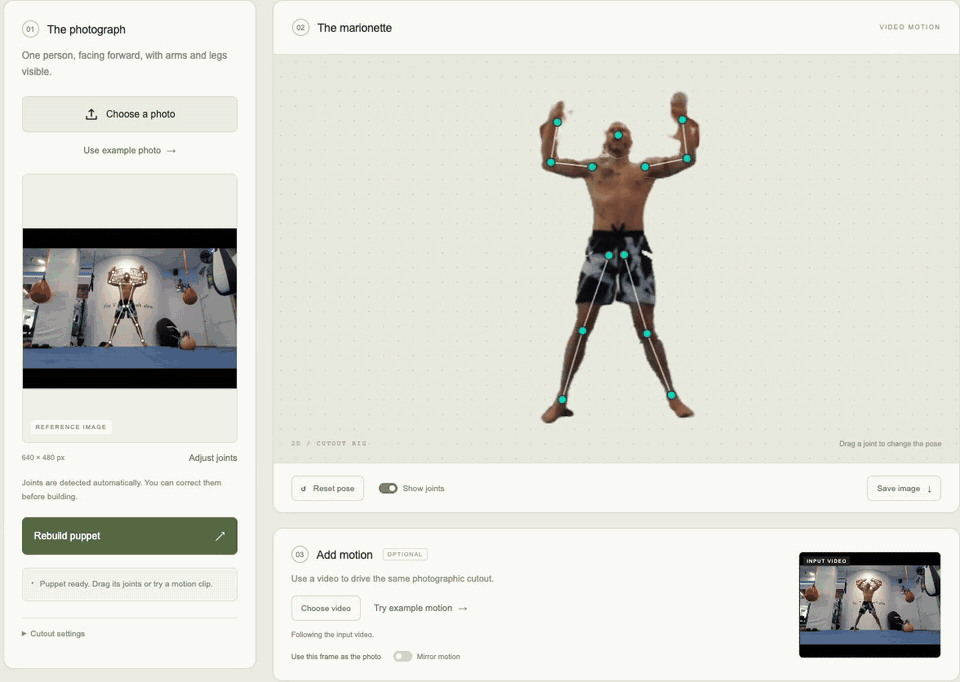

# Puppify — Planar Marionettes: updated work

## Updated work

**[Open the browser demo](https://twerdster.github.io/planar-marionettes/)**

The **new browser implementation** uses MediaPipe pose/foreground inference, geometric body-part cuts and Canvas rendering. Correct joints, drag the puppet, transfer motion from a video and export a transparent PNG. It does not reproduce the historical Caffe/OpenCV/D3 pipeline.

[Detailed implementation, setup and recorded results](DETAILS.md).

Historical project: Elad Richardson and Gil Ben-Shachar; supervision: Anastasia Dubrovina and Aaron Wetzler. New implementations are labeled separately and do not change the preserved materials.

*Recorded browser output using Taco Fleur / Cavemantraining media, CC BY-SA 4.0. [Media sources and changes](media/MEDIA_NOTICES.md).*
